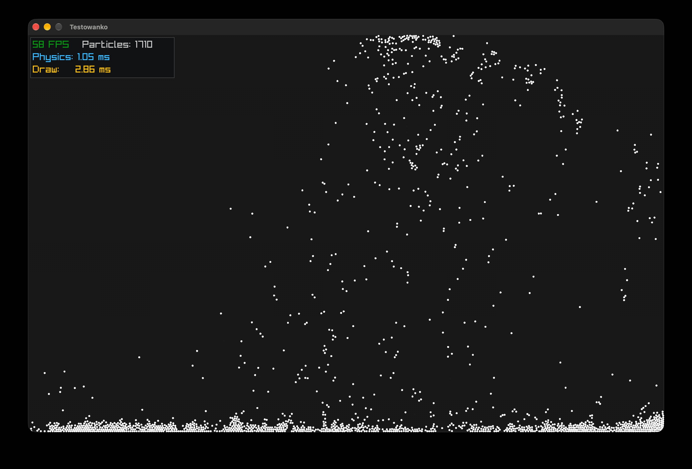

# 2D Verlet Particle Physics Engine

A single-threaded 2D particle physics simulation written from scratch in **C++20** with **Raylib**, capable of simulating **10,000+ particles at 60 FPS**.

<!--  -->

## Key Features

- **Verlet Integration:** 8-pass sub-stepped solver for stable particle stacking and wall damping.
- **$O(n)$ Spatial Grid:** Flat, pre-allocated 1D grid buffers mapping world coordinates to cell buckets in $O(1)$ time.
- **Zero Per-Frame Allocations:** Pre-reserved `std::vector` storage and C++20 `std::span` views prevent heap allocations during the simulation loop.
- **Timing HUD:** Real-time overlay displaying FPS, particle count, and isolated physics vs. render times (`ms`).

## Controls

- **`Left Click (Hold):`** Spawn particles at cursor
- **`SPACE`:** Toggle pendulum emitter
- **`B`:** Spawn 10,000 particles (stress test)
- **`R`:** Reset simulation

## Build & Run

```bash
cmake -B build -DCMAKE_BUILD_TYPE=Release
cmake --build build -j
./build/Physics2D
```